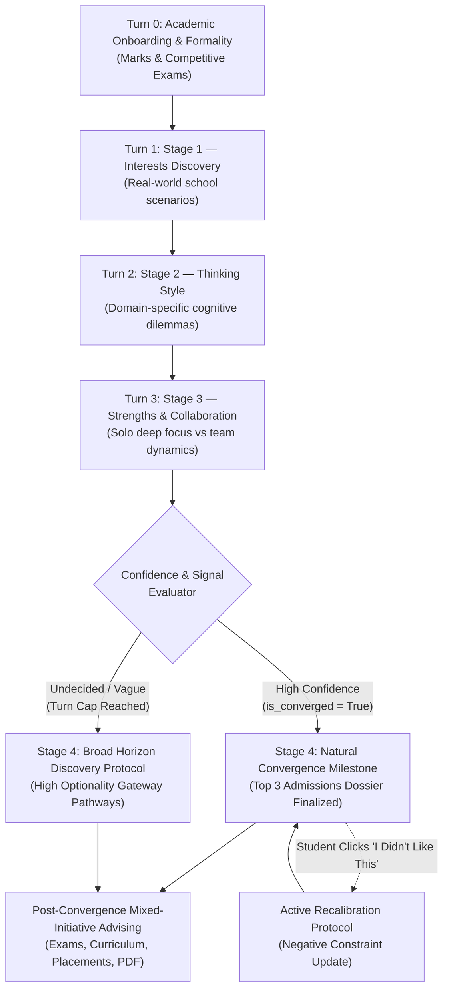

# Flow of Implementation: End-to-End Conversational Lifecycle

This document details the user journey, conversational state machine, turn-by-turn mechanics, and exception protocols of **CareerSaathi**.

---

## 1. The 4-Stage Conversational Lifecycle

Rather than an exhaustive, interrogation-style questionnaire, CareerSaathi delivers a focused, human-like counseling session that naturally synthesizes recommendations in **4 to 5 turns**.

---

## 2. Turn-by-Turn Implementation Mechanics

### Turn 0: Academic Onboarding & Formality
- **Counselor Message**:
  - Time-aware greeting (`Good morning` / `Good afternoon` / `Good evening`).
  - Warm introduction:
    > *"Welcome to CareerSaathi — your personalized AI career & admissions counselor. Before we dive into your counselling and find the perfect stream for you, what are your approximate 10th marks or percentage? Also, are you preparing for or considering any competitive streams (like Science with JEE/NEET, Commerce with CA, or Humanities)?"*
- **Quick Chips**: `["85%+ in 10th", "70% – 85% in 10th", "55% – 70% in 10th", "Under 55% in 10th", "Explore based on interests first"]`.
- **Purpose**: Mimics standard human counselor formality upfront, extracting board performance for admissions reality checks later, while keeping exploration **100% aptitude- and passion-first**.

---

### Turn 1: Stage 1 — Interests Discovery
- **Counselor Message**:
  - Empathetic acknowledgment of the student's score with zero academic pressure.
  - Realistic scenario icebreaker grounded in student life:
    > *"Wonderful! Exploring from your genuine curiosities and natural thinking instincts with zero pressure is the most rewarding way to choose a direction.\n\nImagine your school invites you to lead an initiative: would you rather develop a technical/scientific solution, organize a student-run commercial marketplace, or direct a creative media and storytelling campaign?"*
- **Quick Chips**:
  - `Building software or tech tools`
  - `Science experiments in a lab`
  - `Creative writing, arts or design`
  - `Business, finance or marketing`
- **Engine Processing**:
  - Sentence-BERT maps response to initial RIASEC distribution.
  - SpaCy checks for domain anchors (`tech`, `design`, `business`, `healthcare`).

---

### Turn 2: Stage 2 — Thinking Style
- **Counselor Message**:
  - Guaranteed domain alignment (Guard 3):
    - *Creative Arts Track*: Differentiates between written literature/storytelling vs visual illustration/design.
    - *Tech Track*: Differentiates between backend algorithmic coding vs visual frontend user interface.
    - *Business Track*: Differentiates between market strategy & client pitching vs financial numbers & investing.
    - *Science Track*: Differentiates between biological healthcare & patient therapy vs experimental laboratory research.
- **Example Question (Creative Track)**:
  > *"Wonderful! Within the creative arts and writing: do you feel more drawn to storytelling and writing (like fiction, scripts, and articles), or visual expression (like sketching, painting, and graphic design)?"*
- **Quick Chips**:
  - `Writing stories, articles & scripts`
  - `Visual art, sketching & painting`
  - `Both writing and visual arts`

---

### Turn 3: Stage 3 — Strengths & Collaboration
- **Counselor Message**:
  - Explores working style, problem-solving under uncertainty, or collaboration dynamics without repeating previously discussed topics:
    > *"When you work on creative pieces, do you find yourself energized by deep solo artistic flow in your room, or do you thrive bouncing ideas off others in a collaborative group?"*
- **Quick Chips**:
  - `Deep solo artistic flow`
  - `Collaborative group brainstorming`
  - `Mix of both solo and team`
- **Engine Processing**:
  - Bayesian belief update incorporates work style into Realistic (R) vs Enterprising (E) vs Social (S) scores.
  - Signal Evaluator tests for **Natural Convergence** ($H_{norm} \le 0.88$, distinct domain anchor present, margin $\ge 4.0\%$).

---

### Turn 4 or 5: Convergence Milestone (Admissions Dossier Synthesis)
The moment the system achieves high confidence, **it stops asking questions entirely**. The bot's chat message and the docked banner trigger simultaneously in 100% harmony:

- **Counselor Message**:
  > *"🎯 Based on our conversation across your interests, problem-solving style, and creative storytelling instincts, I have finalized your Admissions Dossier!\n\nRather than locking you into a single rigid path, here are your **Top 3 Recommended Pathways** based on your natural cognitive alignment:\n\n1. **Liberal Studies & Arts Stream (Pathway to B.Sc in Animation, Gaming & Visual Effects (VFX))** (`94.5% Fit`) — Your #1 natural match for your core interests\n2. **Liberal Studies & Arts Stream (Pathway to B.Des in Product Design & Digital UI/UX)** (`87.5% Fit`) — Adjacent specialisation with applied visual depth\n3. **Commerce & Finance Stream (Pathway to Digital Business & Marketing)** (`79.5% Fit`) — Versatile complementary track with broad career flexibility\n\nYour complete academic roadmap, target entrance exams, and feasibility analysis are now ready in the side pane. You can click on any recommendation in your dossier to explore its specific roadmap, or ask me any question about admissions!"*
- **Quick Chips**:
  - `Tell me about entrance exams`
  - `What is the 4-year curriculum like?`
  - `Tell me about campus placements`
  - `Download Official PDF Dossier`
- **Docked Bar**: Automatically un-hides displaying:
  `📄 Admissions Dossier Ready: Liberal Studies & Arts Stream (Pathway to B.Sc in Animation, Gaming & Visual Effects (VFX))`

---

## 3. The Broad Horizon Discovery Protocol

If an adolescent student is genuinely undecided or gives vague answers (*"i don't know"*, *"no idea"*, *"fine"*):
1. **Turn Cap at Turn 6**: The system refuses to trap the student in a 15-turn interrogation loop.
2. **Normalizing Uncertainty**: Instead of forcing a hyper-specialized degree, CareerSaathi delivers a validating closure message:
   > *"🌱 A Personalized Note from your CareerSaathi Counselor:\n\nI've really valued our conversation! Throughout our chat, I noticed that none of the rigid, conventional academic boxes seemed to immediately jump out at you — and that is 100% normal and okay at this stage.\n\nYou don't have an aptitude issue; you simply haven't encountered the specific project that triggers your passion yet. Forcing you into a narrow, hyper-specialized career right now would be an ethical mistake.\n\nInstead, the most strategic decision is **Maximum Optionality**: choosing a broad gateway pathway that keeps 85%+ of career doors open while giving you the next 2 to 3 years to discover what you love."*
3. **Calibrated Exploratory Portfolio**: Recommends 3 broad gateway tracks (e.g., General Science/PCM, Applied Business/Commerce, Multidisciplinary Design/Arts) with calibrated exploratory fit scores (~60–66%), replacing stressful cutoff scores with **low-stakes weekend micro-experiments**.

---

## 4. Human-in-the-Loop Recalibration Protocol

If the student disagrees with the recommendation:
1. Student clicks **"I Didn't Like This Suggestion"** in the dossier.
2. System triggers `action = "recalibrate"`, focusing the chat input with:
   `"I don't like [Degree] because "`
3. The student types their critique (e.g., *"too much sitting at a desk"*, *"hate biology"*, *"want more creative design"*).
4. `apply_negative_feedback()` downweights corresponding RIASEC dimensions, adds the degree and related pathways to `state.excluded_ids`, and recalculates fresh recommendations.
5. In-chat notification card appears:
   `✨ NEW RECOMMENDATION READY: [New Pathway] (Click to review)`.

---

## 5. Post-Convergence Advising & Mixed-Initiative Q&A

Once the dossier is finalized, the student can ask any natural language question:
- *"What is the difference between B.Des and B.Sc in Animation?"*
- *"Can I prepare for CUET alongside 12th board exams?"*
- *"What kind of campus placement packages do students get?"*

The system calls `answer_student_question()`, generating an authoritative, concise (under 40 words) counseling answer without preachy lectures.
