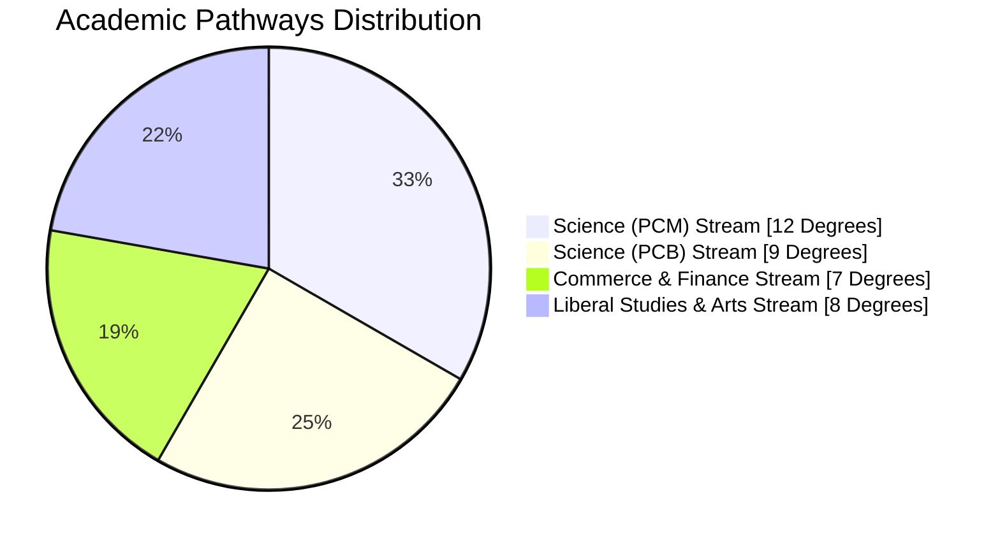
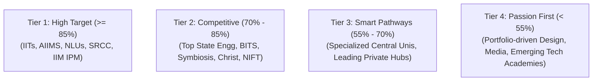

# Educational Ontology & Taxonomy: CareerSaathi

This document catalogues the comprehensive Indian higher education taxonomy, Holland RIASEC psychometric mappings, national entrance examinations, and academic feasibility matrices powering **CareerSaathi**.

---

## 1. 36 Academic Pathways Across 4 Indian Streams

CareerSaathi models 36 distinct higher education pathways covering 100% of major university degree choices in India:

---

### Stream 1: Science (PCM) Stream — 12 Pathways
For students focused on mathematics, physical sciences, software, and engineering:

| Degree ID | Degree Title | Primary RIASEC | Secondary RIASEC | Target National Exams |
| :--- | :--- | :---: | :---: | :--- |
| `btech_cs` | B.Tech in Computer Science & Artificial Intelligence | **I** | **R** | JEE Mains, JEE Advanced, BITSAT |
| `bsc_datascience` | B.Sc in Data Science & Applied Statistics | **I** | **C** | CUET UG, JEE Mains |
| `btech_robotics` | B.Tech in Robotics, Mechatronics & Automation | **R** | **I** | JEE Mains, State CETs |
| `btech_ece` | B.Tech in Electronics, VLSI & IoT Systems | **R** | **I** | JEE Mains, State CETs |
| `btech_mech` | B.Tech in Mechanical & Automobile Engineering | **R** | **I** | JEE Mains, State CETs |
| `btech_aerospace` | B.Tech in Aerospace & Aeronautical Engineering | **R** | **I** | JEE Mains, JEE Advanced |
| `btech_civil` | B.Tech in Civil & Infrastructure Engineering | **R** | **C** | JEE Mains, State CETs |
| `btech_chemical` | B.Tech in Chemical & Materials Engineering | **I** | **R** | JEE Mains, State CETs |
| `barch_architecture` | B.Arch (Architecture & Spatial Planning) | **A** | **R** | NATA, JEE Mains Paper 2 |
| `bsc_aviation` | B.Sc in Aviation & Commercial Pilot License (CPL) | **R** | **E** | DGCA Exams, IGRUA |
| `defense_nda` | National Defence Academy (NDA — Armed Forces) | **R** | **E** | UPSC NDA Exam, SSB Interview |
| `merchant_navy` | Merchant Navy / B.Sc in Nautical Science | **R** | **I** | IMU-CET |

---

### Stream 2: Science (PCB) Stream — 9 Pathways
For students focused on biological sciences, medical healthcare, and life sciences:

| Degree ID | Degree Title | Primary RIASEC | Secondary RIASEC | Target National Exams |
| :--- | :--- | :---: | :---: | :--- |
| `mbbs_healthcare` | MBBS / Clinical Healthcare & Medicine | **I** | **S** | NEET UG |
| `b_pharm` | B.Pharm (Pharmacy & Pharmaceutical Sciences) | **I** | **R** | NEET UG, State CETs, CUET UG |
| `bsc_lifesciences` | B.Sc in Life Sciences, Biotechnology & Genetics | **I** | **R** | CUET UG, NEET UG, GAT-B |
| `bpt_physiotherapy` | BPT (Physiotherapy & Sports Rehabilitation) | **S** | **R** | NEET UG, State Medical Entrances |
| `bvsc_veterinary` | B.V.Sc (Veterinary Science & Animal Husbandry) | **I** | **R** | NEET UG |
| `bds_dental` | BDS (Bachelor of Dental Surgery) | **R** | **I** | NEET UG |
| `bsc_nursing` | B.Sc in Nursing & Critical Care | **S** | **C** | NEET UG, State Nursing Entrances |
| `ayush_medicine` | BAMS / BHMS (Ayurvedic & Alternative Medicine) | **I** | **S** | NEET UG |
| `allied_health` | B.Sc in Allied Health Sciences (Radiology/Lab Tech)| **R** | **I** | CUET UG, University Entrances |

---

### Stream 3: Commerce & Finance Stream — 7 Pathways
For students focused on business operations, financial markets, and statutory governance:

| Degree ID | Degree Title | Primary RIASEC | Secondary RIASEC | Target National Exams |
| :--- | :--- | :---: | :---: | :--- |
| `bba_analytics` | BBA in Business Analytics & Entrepreneurship | **E** | **I** | IPMAT, SET, CUET UG, NMIMS NPAT |
| `ca_bcom` | Chartered Accountancy (CA) & B.Com (Professional) | **C** | **E** | ICAI CA Foundation, CUET UG |
| `bcom_fintech` | B.Com in FinTech & Investment Banking | **E** | **C** | CUET UG, NMIMS NPAT |
| `actuarial_science`| B.Sc / B.Com in Actuarial Science & Risk Analytics | **C** | **I** | ACET (IAI), CUET UG |
| `bhm_hospitality` | BHM (Hotel Management & Luxury Hospitality) | **E** | **S** | NCHMCT JEE |
| `cs_corporate_law` | Company Secretary (CS) & Corporate Governance | **C** | **E** | ICSI CSEET |
| `cma_cost_accounting` | CMA (Cost & Management Accounting) | **C** | **E** | ICMAI Foundation |

---

### Stream 4: Liberal Studies, Humanities & Design — 8 Pathways
For students focused on creative design, visual media, law, psychology, and public policy:

| Degree ID | Degree Title | Primary RIASEC | Secondary RIASEC | Target National Exams |
| :--- | :--- | :---: | :---: | :--- |
| `bdes_uiux` | B.Des in Product Design & Digital UI/UX | **A** | **R** | UCEED, NID DAT, NIFT |
| `bdes_fashion` | B.Des in Fashion Design & Apparel Styling | **A** | **E** | NIFT, NID DAT |
| `ballb_law` | B.A. LL.B (Hons) in Corporate Law & Advocacy | **E** | **A** | CLAT (NLUs), AILET |
| `bjmc_media` | B.A. in Journalism, Media & Mass Communication | **A** | **E** | CUET UG, IIMC |
| `ba_psychology` | B.A. (Hons) in Psychology & Behavioral Science | **S** | **I** | CUET UG |
| `ba_economics` | B.A. (Hons) in Economics & Public Policy | **I** | **E** | CUET UG |
| `bsc_animation_vfx`| B.Sc in Animation, Gaming & Visual Effects (VFX)| **A** | **R** | University Entrances, CUET UG |
| `ba_public_admin` | B.A. in Public Administration (Civil Services/UPSC)| **S** | **E** | CUET UG |

---

## 2. Stream Affinity Weighting Matrix ($W_{\text{Stream}} \times S$)

To project 6-dimensional RIASEC scores into percentage affinities across the 4 Indian academic streams, CareerSaathi uses a normalized expert knowledge matrix:

$$W_{\text{Stream}} = \begin{bmatrix}
w_{\text{PCM}, R} & w_{\text{PCM}, I} & w_{\text{PCM}, A} & w_{\text{PCM}, S} & w_{\text{PCM}, E} & w_{\text{PCM}, C} \\
w_{\text{PCB}, R} & w_{\text{PCB}, I} & w_{\text{PCB}, A} & w_{\text{PCB}, S} & w_{\text{PCB}, E} & w_{\text{PCB}, C} \\
w_{\text{Comm}, R} & w_{\text{Comm}, I} & w_{\text{Comm}, A} & w_{\text{Comm}, S} & w_{\text{Comm}, E} & w_{\text{Comm}, C} \\
w_{\text{Arts}, R} & w_{\text{Arts}, I} & w_{\text{Arts}, A} & w_{\text{Arts}, S} & w_{\text{Arts}, E} & w_{\text{Arts}, C}
\end{bmatrix}$$

- **Science (PCM)**: Heavily weights **Investigative (0.40)** and **Realistic (0.35)**.
- **Science (PCB)**: Heavily weights **Investigative (0.42)** and **Social (0.30)**.
- **Commerce & Finance**: Heavily weights **Conventional (0.40)** and **Enterprising (0.35)**.
- **Liberal Studies & Arts**: Heavily weights **Artistic (0.45)** and **Social (0.25)**.

$$\text{Affinity}(Stream) = \frac{\sum_{k} W_{Stream, k} \cdot S(k)}{\sum_{j} \text{Affinity}(Stream_j)} \times 100\%$$

---

## 3. Top 3 Recommendation Architecture

CareerSaathi rejects the traditional practice of outputting a single career track. Instead, it presents a **Top 3 Recommended Portfolio**:

1. **#1 Top Recommended Pathway (Primary Match)**:
   - Alignment with the dominant primary psychometric centroid and active user interest keywords.
   - Calibrated fit score:
     $$\text{Fit}_1 = \min\left(95.0, \max\left(91.0, 89.0 + (S_{(1)} \times 0.12)\right)\right)$$
2. **#2 Adjacent Specialisation (Applied Alternative)**:
   - Shares the same stream or primary/secondary trait, offering applied depth.
   - Calibrated fit score:
     $$\text{Fit}_2 = \max\left(84.0, \text{Fit}_1 - 7.0\right)$$
3. **#3 Versatile Alternative (Complementary Track)**:
   - Cross-disciplinary option providing a strategic safety net.
   - Calibrated fit score:
     $$\text{Fit}_3 = \max\left(76.0, \text{Fit}_2 - 8.0\right)$$

In **Exploratory (Broad Horizon) Mode**, fit scores are calibrated to $\approx 66.0\%$, $60.0\%$, and $55.0\%$ to accurately communicate high optionality and ongoing discovery without artificial certainty.

---

## 4. Academic Feasibility Matrix Calibration

The Admissions Dossier generates a feasibility matrix calibrated across 4 student score tiers:

For every recommended degree, CareerSaathi renders:
- **Tier 1 (Dream Institute)**: Cutoff requirements, percentile targets, entrance weighting.
- **Tier 2 (Solid Match)**: State quota guidelines, direct admission gateways.
- **Tier 3 (Safe Harbor)**: Vocational pathways, dual-degree options, lateral entry.
- **Prep Time Allocation**: Strategic weekly balance between Board Exams (40%) and Entrance Gateways (60%).
