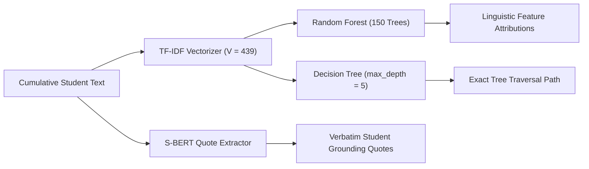

# Pipeline & Models: Mathematical & Algorithmic Specification

This document provides a rigorous mathematical, statistical, and algorithmic specification of every machine learning model, embedding space, psychometric metric, and natural language generation system utilized in **CareerSaathi**.

---

## 1. Sentence-BERT Semantic Vector Space (`all-MiniLM-L6-v2`)

### 1.1 Architecture & Dimensionality
To evaluate student answers semantically rather than relying on brittle keyword matching, CareerSaathi employs a dual-encoder transformer architecture: **Sentence-BERT (`all-MiniLM-L6-v2`)**.

- **Dense Embedding Dimension**: $D = 384$
- **Sequence Length Limit**: 256 WordPiece tokens
- **Pooling Strategy**: Mean Pooling across contextualized token representations

### 1.2 Holland RIASEC Centroid Formulation
Holland's RIASEC theory posits six core personality and cognitive types:
- **R**: Realistic (Practical, Hands-on, Physical systems)
- **I**: Investigative (Analytical, Scientific, Algorithmic)
- **A**: Artistic (Creative, Expressive, Narrative, Visual)
- **S**: Social (Empathetic, Helping, Healing, Community)
- **E**: Enterprising (Leadership, Commercial, Persuasion)
- **C**: Conventional (Structured, Systematic, Quantitative)

For each code $k \in \{R, I, A, S, E, C\}$, CareerSaathi constructs an authoritative anchor corpus $A_k = \{a_{k,1}, a_{k,2}, \dots, a_{k,m}\}$ derived from standardized vocational psychometrics (O*NET and Indian academic frameworks).

The centroid prototype vector $C_k \in \mathbb{R}^{384}$ is pre-computed at application startup:
$$C_k = \frac{1}{|A_k|} \sum_{a \in A_k} \text{SBERT}(a)$$
$$C_k = \frac{C_k}{\|C_k\|_2}$$

### 1.3 Cosine Similarity & Softmax Temperature Calibration
Given the student's cumulative conversation history text $T$, the student vector is computed as:
$$\vec{u} = \frac{\text{SBERT}(T)}{\|\text{SBERT}(T)\|_2} \in \mathbb{R}^{384}$$

The raw projection onto centroid $k$ is given by the inner product (cosine similarity):
$$\text{sim}(\vec{u}, C_k) = \vec{u} \cdot C_k$$

To transform raw cosine similarities into a calibrated probability distribution over the 6 dimensions, CareerSaathi applies a **temperature-scaled Softmax** ($\tau = 0.32$):
$$P(k) = \frac{\exp\left(\frac{\text{sim}(\vec{u}, C_k)}{\tau}\right)}{\sum_{j \in \{R,I,A,S,E,C\}} \exp\left(\frac{\text{sim}(\vec{u}, C_j)}{\tau}\right)}$$

The final scores are expressed as percentages:
$$S_{\text{turn}}(k) = P(k) \times 100 \quad \text{where} \quad \sum_{k} S_{\text{turn}}(k) = 100\%$$

---

## 2. Bayesian Belief State Tracking

Student career exploration is not a static measurement; it evolves dynamically across conversation turns. CareerSaathi tracks this evolution using a **Bayesian Exponential State Update**:

$$S_t(k) = (1 - \alpha) S_{t-1}(k) + \alpha S_{\text{turn}}(k)$$

- $S_{t-1}$: Prior belief vector over RIASEC dimensions.
- $S_{\text{turn}}$: Observation vector computed from the latest dialogue context.
- $\alpha = 0.55$: Empirical learning rate providing responsive adaptation to new student input while maintaining conversation stability.

### 2.1 Negative Evidence Incorporation (Active Constraint Learning)
When a student rejects a suggestion (via *"I didn't like this"* or explicitly stating *"I hate math"*, *"not into coding"*), the system applies active negative feedback:
1. Downweights the rejected RIASEC dimensions:
   $$S_{\text{recal}}(C) = \max\left(2.0, S(C) \times 0.30\right)$$
   $$S_{\text{recal}}(I) = \max\left(4.0, S(I) \times 0.40\right)$$
2. Appends corresponding degrees to `state.excluded_ids` (blacklist propagation).
3. Renormalizes $\sum S(k) = 100\%$.

---

## 3. Information Theory: Shannon Entropy & Signal Evaluation

To prevent premature recommendations and eliminate endless redundant questions, CareerSaathi uses **Shannon Entropy** from Information Theory to measure psychometric ambiguity.

### 3.1 Normalized Shannon Entropy
Given the probability distribution $P = \{p_R, p_I, p_A, p_S, p_E, p_C\}$ where $p_k = \frac{S(k)}{100}$:
$$H(P) = -\sum_{k \in \{R,I,A,S,E,C\}} p_k \log_2(p_k)$$

The maximum possible entropy occurs under complete uniformity ($p_k = \frac{1}{6}$ for all $k$):
$$H_{\max} = \log_2(6) \approx 2.585 \text{ bits}$$

The **Normalized Shannon Entropy** $H_{\text{norm}}$ maps certainty to the unit interval $[0.0, 1.0]$:
$$H_{\text{norm}} = \frac{H(P)}{H_{\max}}$$
- $H_{\text{norm}} \approx 1.00$: Total uncertainty (student has shared no distinctive preference).
- $H_{\text{norm}} \le 0.85$: High confidence (clear cognitive peak in 1 or 2 dimensions).

### 3.2 Dynamic Signal & Convergence Gate
The system assesses conversational signal using multi-factor criteria:
1. **Substantive Words**: Informative tokens (nouns, verbs, adjectives with length $> 2$, excluding stopwords and numbers).
2. **Domain Anchors Hit**: Matches in 6 domain dictionaries (tech, hardware, healthcare, business, design, social).
3. **Decisive Choice Detection**: Short decisive words like *"solo"*, *"team"*, *"stories"*, *"games"*, *"design"* are recognized as informative anchors, preventing false "vague" flags.
4. **Margin of Certainty**: Difference between top 2 RIASEC scores:
   $$\Delta = S_{(1)} - S_{(2)}$$

#### Convergence Conditions (Dossier Ready in 4–5 Turns)
```python
is_converged = (
    (total_turns >= 4 and (len(domain_hits) >= 1 or substantive_words >= 6) and (margin >= 4.0 or top_score >= 21.0 or h_norm <= 0.88) and vague_ratio < 0.60)
    or (total_turns >= 5 and vague_ratio < 0.60)
)
```

---

## 4. Linguistic Preprocessing & Morpheme Extraction (SpaCy)

CareerSaathi utilizes the SpaCy `en_core_web_sm` pipeline optimized for fast on-device linguistic parsing:
- **Chat Abbreviation Expansion**: Regex-driven dictionary mapping colloquial abbreviations (`idk` ➔ `i do not know`, `cs` ➔ `computer science`, `engg` ➔ `engineering`).
- **Academic Score Extractor**: Identifies percentages (e.g., `89%`, `92.5 percent`) and categorizes them into 4 logistical tiers:
  - *High Target* ($\ge 85\%$)
  - *Competitive* ($70\% - 85\%$)
  - *Smart Pathways* ($55\% - 70\%$)
  - *Foundational / Passion First* ($< 55\%$)
- **Syntactic Intent Tagging**:
  - `is_interrogative`: Identifies whether the student asked a question (initiating mixed-initiative advising mode).
  - `is_uncertain`: Flags hesitation words (*"maybe"*, *"not sure"*, *"confused"*).

---

## 5. Explainable AI (XAI) Feature Attribution Engine

To demystify recommendations and provide transparent reasoning, CareerSaathi combines three explainability layers:



1. **TF-IDF Sparse Representation**:
   - $V = 439$ n-gram vocabulary dimensions (unigrams and bigrams).
   - Sublinear term-frequency scaling: $\text{tf} = 1 + \log(\text{count})$.
2. **Decision Tree Rule Traversal (`max_depth=5`)**:
   - Traces the exact binary feature splits leading to the recommended academic stream:
     `[coding > 0.18] ➔ [software > 0.12] ➔ Science (PCM) Stream`
3. **Verbatim S-BERT Quote Grounding**:
   - Locates the student's exact statements from dialogue history that had the highest cosine alignment with the recommended degree's profile.

---

## 6. On-Device Dialogue Generation: Gemma-2B via Ollama

To ensure 100% student data privacy and operate completely offline, dialogue generation is powered by **Google Gemma-2B** running on a local Ollama service (`http://localhost:11434/api/generate`) accelerated by the user's GPU.

### 6.1 Generation Parameters
```json
{
  "model": "gemma2:2b",
  "stream": false,
  "options": {
    "temperature": 0.55,
    "top_p": 0.88,
    "num_predict": 80
  }
}
```

### 6.2 Multi-Layer Dialogue Guardrails

Because small language models (2B parameters) are prone to pretraining biases, CareerSaathi surrounds Gemma-2B with **7 Deterministic Architectural Guards**:

```mermaid
flowchart TD
    Input["User Answer"] --> G1{"Guard 1: Negation / Disavowal?"}
    G1 -- Yes --> R1["Pivot away from disavowed domain + Add to Blacklist"]
    G1 -- No --> G2{"Guard 2: Confusion / 'Meaning?'?"}
    
    G2 -- Yes --> R2["Direct Simplification (No Metaphors)"]
    G2 -- No --> G3{"Guard 3: Turn 2 Guaranteed Alignment?"}
    
    G3 -- Yes --> R3["Strict Domain Dilemma (Arts vs Tech vs Comm vs Sci)"]
    G3 -- No --> G4{"Guard 4: Self-Doubt ('I don't know')?"}
    
    G4 -- Yes --> R4["Progressive Empathetic Validation + Low Pressure Options"]
    G4 -- No --> GemmaGen["Gemma-2B Prompt Generation"]
    
    GemmaGen --> G5{"Guard 5: Rogue Game/App Mention in Arts Track?"}
    G5 -- Yes --> FilterG5["Strip Rogue Token & Replace with Artistic Dilemma"]
    G5 -- No --> G6{"Guard 6: Repetition Breaker?"}
    
    G6 -- Yes --> FreshQ["Select Fresh Question (Anti-Redundancy)"]
    G6 -- No --> Output["Final Bot Response + 1.25s Pacing Delay"]
    FilterG5 --> Output
    FreshQ --> Output
    R1 --> Output
    R2 --> Output
    R3 --> Output
    R4 --> Output
```

1. **Guard 1 (Regex Disavowal Interceptor)**: Detects phrases like `"not into gaming"`, `"don't like coding"`. Instantly acknowledges, pivots, and blacklists the degree.
2. **Guard 2 (Confusion & Non-Comprehension Interceptor)**: Detects `"i did not get it"`, `"didn't understand"`, `"meaning?"`, `"mean?"`. Replaces philosophical AI essays with simple binary everyday choices.
3. **Guard 3 (Turn 2 Deterministic Stream Alignment)**: Guarantees that selecting *Creative Writing / Arts* in Turn 1 never asks about designing games or apps in Turn 2.
4. **Guard 4 (Progressive Self-Doubt Reassurance)**:
   - First *"i don't know"*: Delivers warm normalization ("discovering what clicks for you is why we're exploring without pressure").
   - Repeated *"i don't know"*: Dynamically pivots to agency ("No pressure at all! Would you like to explore your initial recommended career pathways right now...?") with a one-click chip `[Show me recommended pathways now]`.
5. **Guard 5 (Rogue Output Filter)**: Intercepts and replaces accidental mentions of video games or apps in the Creative Arts track.
6. **Guard 6 (Anti-Redundancy & Repetition Breaker)**: Cross-checks proposed questions against the complete conversation history. If any thematic prompt or question was already asked, it selects a fresh forward-looking dilemma.
7. **Guard 7 (Natural Thinking Cadence)**: Imposes an intentional ~1.25s minimum thinking duration in the frontend so the student sees `CareerSaathi is thinking •••` before the reply renders, eliminating the jarring "hardcoded bot" feeling.
