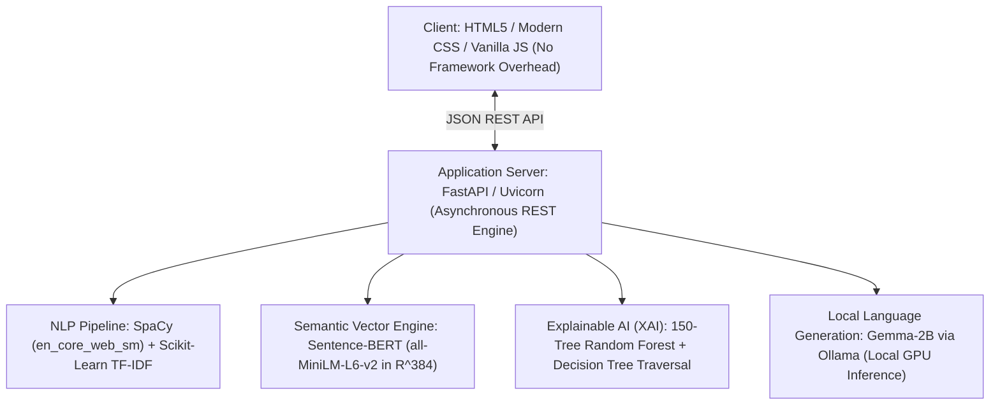

# CareerSaathi: Documentation Suite

Welcome to the official technical and architectural documentation for **CareerSaathi** — a Cognitive Career & Admissions Advisory Suite powered by Empirical NLP, Explainable AI (XAI), Holland's RIASEC Psychometric Theory, and On-Device Dialogue Generation.

---

## 📚 Documentation Index

| Document | Description |
| :--- | :--- |
| **[ARCHITECTURE.md](file:///D:/CareerSaathi/docs/ARCHITECTURE.md)** | Full system architecture, dual-tier client-server topology, data pipelines, state management, and real-time telemetry flow. |
| **[PIPELINE_AND_MODELS.md](file:///D:/CareerSaathi/docs/PIPELINE_AND_MODELS.md)** | Deep mathematical, statistical, and algorithmic specifications of all models: S-BERT, TF-IDF, Random Forest, Decision Tree XAI, Shannon Entropy, and Local Gemma-2B NLG. |
| **[FLOW_OF_IMPLEMENTATION.md](file:///D:/CareerSaathi/docs/FLOW_OF_IMPLEMENTATION.md)** | End-to-end conversational lifecycle: Academic Onboarding, Interest Discovery, Cognitive Dilemmas, Strengths & Collaboration, Convergence Milestone, Broad Horizon Protocol, and Active Recalibration. |
| **[ONTOLOGY_AND_DATA.md](file:///D:/CareerSaathi/docs/ONTOLOGY_AND_DATA.md)** | Comprehensive Indian educational ontology: 36 academic pathways across 4 streams, Holland RIASEC code matrices, national entrance exams, and 4-tier feasibility scoring. |

---

## 🎯 Executive Summary & Significance

Choosing an academic stream after 10th Standard or an undergraduate degree after 12th Standard is one of the highest-stakes decisions in an Indian student's life. Traditional counseling in India suffers from severe structural flaws:
1. **Rote Aptitude Forms**: Rigid 100-question multiple-choice questionnaires that feel like tests and encourage students to guess or game the answers.
2. **Marks-First Pigeonholing**: Forcing high scorers into Science (PCM/PCB) regardless of genuine cognitive instinct, leading to severe burnout and career misalignment.
3. **Tunnel-Vision Single Recommendations**: Recommending a single rigid degree (e.g., only "B.Tech Computer Science") without revealing adjacent creative, analytical, or commercial alternatives.
4. **Cloud Privacy Risks**: Sending sensitive adolescent self-reflections, academic percentages, and career uncertainties to opaque third-party cloud APIs.

**CareerSaathi solves this through an empirical, empathetic, and privacy-preserving cognitive advisory engine**:
- **A Conversation, Not a Form**: Natural, empathetic, mixed-initiative dialogue grounded in real-world Indian student life (exhibitions, clubs, trade stalls, creative writing, gadgets).
- **Dual-Model Cognitive Grounding**: Dense semantic vector embeddings (Sentence-BERT in $\mathbb{R}^{384}$) coupled with Holland's RIASEC psychometric theory track cognitive affinity across 6 dimensions in real time.
- **Shannon Entropy & Natural Convergence**: Uses Information Theory ($H_{norm}$) to quantify conversational certainty, finalizing recommendations in 4 to 5 turns when signal is clear, while preventing premature forced specialization for undecided students via the **Broad Horizon Protocol**.
- **100% Local On-Device AI**: Powered by **Gemma-2B via local Ollama** accelerated on the local GPU, ensuring zero student data leaves the machine.
- **Explainable AI (XAI) & Human-in-the-Loop**: Every recommendation provides exact feature attributions, Sentence-BERT quote grounding, a Decision Tree split path, and a one-click Recalibration mechanism ("I Didn't Like This").

---

## 🛠️ Technology Stack Summary

- **Frontend**: Vanilla ECMAScript (ES2022), Glassmorphism CSS design system, SVG Radar Charts, CSS Flexbox/Grid responsive split-screen pane, KaTeX mathematical typesetting, zero external framework dependencies.
- **Backend Framework**: FastAPI (0.115+), Uvicorn ASGI server, Pydantic data schemas.
- **NLP & Psychometrics**:
  - **Sentence-BERT (`all-MiniLM-L6-v2`)**: Dense 384-dimensional semantic space for Holland RIASEC centroid projection.
  - **SpaCy (`en_core_web_sm`)**: Rule-based linguistic parsing, lemmatization, and morpheme extraction.
  - **Scikit-Learn**: 439-dimensional TF-IDF vectorizer, 150-tree Random Forest Ensemble, max-depth 5 Decision Tree XAI engine.
- **Local NLG Engine**: Gemma-2B (Ollama instance on `localhost:11434`), constrained prompt engineering, regex guardrails, and deterministic fallback generators.
- **Operating Environment**: Fully on-device, offline-capable, zero external cloud dependency during live counseling turns.
