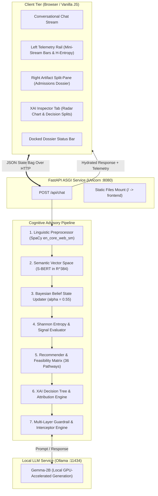
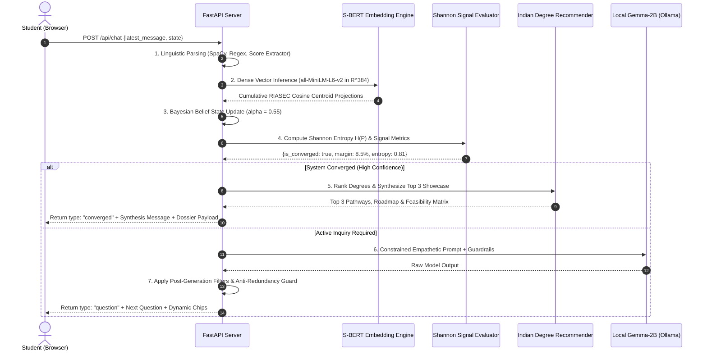

# System Architecture: CareerSaathi

This document specifies the system architecture, dual-tier client-server topology, data pipelines, state management, and real-time telemetry synchronization of **CareerSaathi**.

---

## 1. High-Level Architectural Topology

CareerSaathi is built as a **privacy-first, on-device cognitive computing system**. It pairs a responsive glassmorphic web interface with an asynchronous FastAPI backend and a local Ollama Large Language Model instance, running 100% on the user's hardware.



---

## 2. Client Architecture (Single-Page Application)

The frontend is implemented in standard ECMAScript (ES2022) with zero frontend framework dependencies (no React, Angular, or Vue). This guarantees instant load times, zero bundle compilation delays, and deterministic DOM rendering.

### 2.1 Component Structure

1. **Top Application Navigation Bar** (`.app-navbar`):
   - Brand identifier with one-click return to Landing View.
   - Dynamic pathway badge (`After 10th: Choosing a stream` vs `After 12th: Choosing a degree`).
   - Quick action controls: *📄 View Admissions Dossier*, *🔬 AI Reasoning (XAI)*, and *↺ Restart Session*.
2. **Left Telemetry Rail** (`.journey-rail`):
   - Real-time Normalized Shannon Entropy readout ($H \in [0.00, 1.00]$).
   - Live 4-Stream percentage affinity bars (Science PCM, Science PCB, Commerce & Finance, Liberal Studies & Arts).
   - Dynamic 3-stage Journey Progress indicator (Interests ➔ Thinking Style ➔ Strengths).
3. **Center Chat Pane** (`.chat-pane`):
   - Header displaying current cognitive stage and stage-specific guiding subtext.
   - Chat message bubble stream (Bot bubbles with left crimson brand accent; User bubbles in deep crimson `#a81d24`).
   - Natural Thinking Bubble (`.chat-loading-bubble`): Displays *CareerSaathi is thinking* with animated dots and crimson branding for ~1.3 seconds, creating an authentic human-like pacing.
   - Contextual Quick-Reply Chips (`.quick-chips-wrapper`): Dynamically rendered binary and tertiary chips matching the active dilemma.
   - Docked Dossier Banner (`.docked-dossier-bar`): Fixed directly above the input box. Remains hidden during active inquiry and un-hides in harmony with the recommendation closure message.
   - Multi-line autosizing textarea with `Enter` (send) and `Shift+Enter` (newline) bindings.
4. **Right Artifact Split-Pane** (`.artifact-split-pane`):
   - Tab 1: **Admissions Dossier** (`#content-student-dossier`):
     - Top 3 Recommendation Showcase (#1 Hero Top Pathway with active roadmap pill; #2 Adjacent Specialisation; #3 Versatile Alternative).
     - Interactive switching: clicking on #2 or #3 dynamically swaps the 4-year curriculum, national entrance exams, and feasibility matrix.
     - 6-dimension horizontal RIASEC percentage bar charts.
     - 4-year semester curriculum blueprint.
     - National Entrance Exam gateway matrix (JEE, NEET, CUET, IPMAT, UCEED, CLAT, etc.).
     - Academic feasibility matrix calibrated across 4 score tiers.
     - Official Print / Download PDF engine with automatic print stylesheet.
   - Tab 2: **AI Reasoning & Telemetry (XAI)** (`#content-examiner-xai`):
     - Interactive 6-axis SVG Spider Radar Chart plotted dynamically in SVG coordinate space.
     - Mathematical metric counters ($H_{norm}$ Shannon Entropy, Confidence Tier, Active Mode).
     - Morpheme extraction table and linguistic attributions.
     - Exact Decision Tree branch traversal (`[node 0] -> [node 2] -> leaf`).

---

## 3. Server Architecture & API Specification

The backend service is powered by **FastAPI** mounted via an ASGI **Uvicorn** worker on `http://127.0.0.1:8080`.

### 3.1 Primary Endpoint: `POST /api/chat`

The endpoint is completely stateless on disk, managing conversation flow through a client-transmitted **State Bag** (`ChatState`).

#### Request Schema (`ChatState` Pydantic Model)
```json
{
  "turn_count": 3,
  "phase": "scenario",
  "level": "after_10th",
  "education_level": "10th Standard",
  "stream": "General",
  "history": [
    {"role": "assistant", "content": "Welcome!..."},
    {"role": "user", "content": "89%"}
  ],
  "riasec_state": {"R": 16.7, "I": 16.7, "A": 16.7, "S": 16.7, "E": 16.7, "C": 16.7},
  "latest_message": "the satisfaction of a well crafted story",
  "action": "chat",
  "excluded_ids": [],
  "rejected_degree": null,
  "score_tier": "competitive",
  "score_raw": "89%"
}
```

#### Response Payload Schema
```json
{
  "type": "converged",
  "question": "🎯 Based on our conversation... here are your Top 3 Recommended Pathways...",
  "options": ["Tell me about entrance exams", "What is the 4-year curriculum like?", "Download Official PDF Dossier"],
  "can_complete": true,
  "is_updated_recommendation": true,
  "stage": 4,
  "stage_name": "Your recommendation",
  "report": { ... },
  "state": { ... },
  "telemetry": {
    "riasec": {"R": 18.2, "I": 20.4, "A": 34.6, "S": 12.1, "E": 8.3, "C": 6.4},
    "entropy": 0.812,
    "dialogue_mode": "CONVERGED (High Confidence)",
    "indian_streams": {"Liberal Studies & Arts": 41.1, "Science (PCB)": 23.1, ...},
    "highlights": [...],
    "decision_path": [...]
  }
}
```

---

## 4. End-to-End Data Flow Pipeline

Each conversational turn passes through a 7-stage computational pipeline:



---

## 5. Security, Privacy & Stateless Boundary

1. **Zero External Data Exfiltration**:
   - Dense semantic embeddings are computed locally using HuggingFace `sentence-transformers` loaded into local system RAM/VRAM.
   - Text generation runs through `ollama` on `http://localhost:11434`.
   - No student utterances, board scores, or psychometric traces are ever transmitted over external networks.
2. **Stateless Server Architecture**:
   - The FastAPI server retains no database sessions or student identifiers in server memory.
   - The entire conversational history and RIASEC state bag is held securely in the client browser session and transmitted per request.
   - Restarting the server never corrupts or deletes ongoing student sessions.
