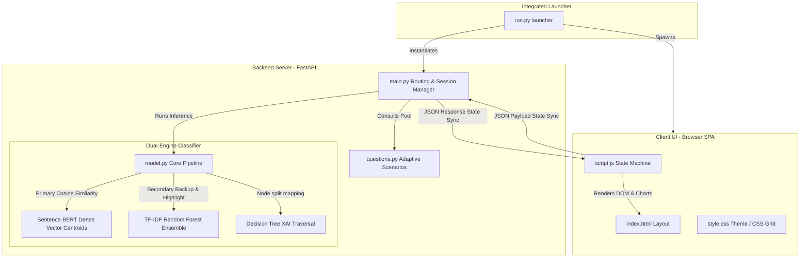
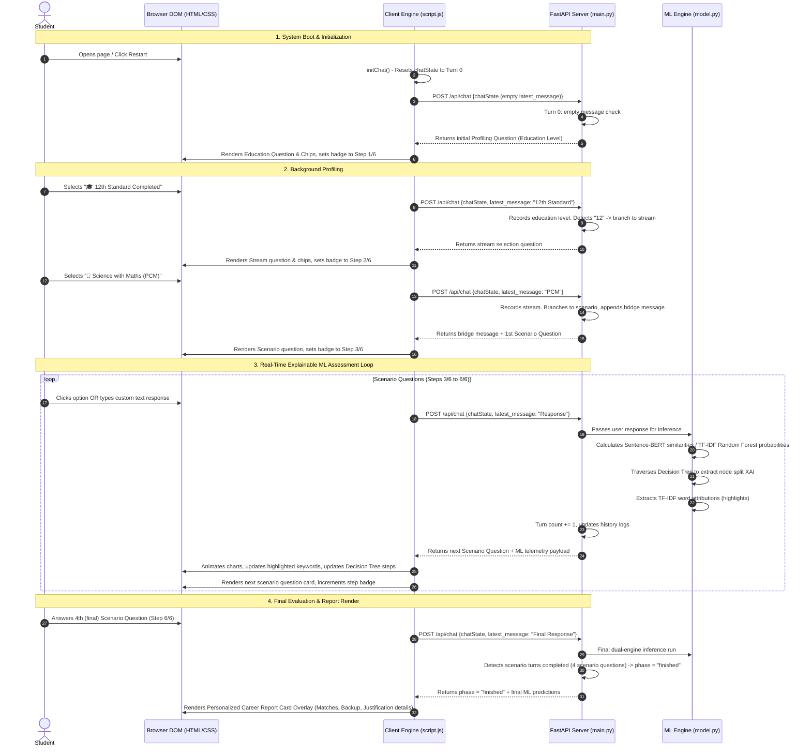

# 🏗️ AuraPath AI: Integrated System Architecture & Lifecycle

This document provides a highly detailed explanation of the **AuraPath AI** system architecture, system sequence flows, state machine specifications, client-server data synchronization contracts, and backend routing endpoints. It is designed to help team members quickly understand the inner engineering operations of the codebase.

---

## 📌 Architectural Blueprint

AuraPath AI is constructed as a decoupled **Client-Server Single-Page Web Application (SPA)** utilizing a unified launcher. It blends high-performance web frameworks with state-of-the-art Python machine learning and deep learning dependencies.



---

## 🔄 Client-Server Sequence Flow & Lifecycle

The application operates on a strict **State-Passing Protocol**. The client acts as the single source of truth for the conversation history and configuration variables, passing the complete state to the server on every request. The server functions as a stateless mathematical computer, updating the state variables and returning them alongside the classification predictions.



---

## 📊 Client-Server API State Contracts

### 1. Request Protocol: `POST /api/chat`
The request must contain the entire current state serialised inside the JSON body:

```json
{
  "turn_count": 2,
  "phase": "scenario",
  "education_level": "12th Standard",
  "stream": "PCM",
  "asked_question_ids": ["general_start"],
  "history": [
    {"role": "assistant", "content": "First, what is your current education level?"},
    {"role": "user", "content": "12th Standard"},
    {"role": "assistant", "content": "Which academic stream did you study?"},
    {"role": "user", "content": "PCM"},
    {"role": "assistant", "content": "Great, PCM stream!... Imagine your school or colony is organizing..."}
  ],
  "latest_message": "The Tech Lead: Building the registration website, databases..."
}
```

### 2. Response Protocol
The server processes the payload and returns the next conversation block along with full machine learning telemetry:

```json
{
  "type": "question",
  "question": "Imagine you are designing a high-tech smart lock system for a secure vault. What is the most satisfying part of the setup?",
  "options": [
    {"text": "💻 Writing the software algorithm that encrypts credentials", "value": "I love coding software algorithms..."},
    {"text": "🔌 Wiring up the electronic locks, batteries, and sensors", "value": "I want to wire electronic microchips..."},
    {"text": "🛠️ Assembling the physical steel frame and mechanical hinges", "value": "Tinkering with heavy mechanical locks..."},
    {"text": "📊 Sourcing parts under budget and selling to banks", "value": "Negotiating with suppliers, pitching business..."}
  ],
  "state": {
    "turn_count": 3,
    "phase": "scenario",
    "education_level": "12th Standard",
    "stream": "PCM",
    "asked_question_ids": ["general_start", "cs_vault"],
    "history": [
      "...[all previous history]...",
      {"role": "user", "content": "The Tech Lead: Building the registration website, databases..."},
      {"role": "assistant", "content": "Imagine you are designing a high-tech smart lock..."}
    ],
    "latest_message": ""
  },
  "ml_data": {
    "probabilities": {
      "Computer Science": 82.4,
      "Management": 8.2,
      "Electrical Engineering": 4.1,
      "Mechanical Engineering": 2.1,
      "Civil Engineering": 1.0,
      "Biology": 0.8,
      "Chemistry": 0.8,
      "Physics": 0.6
    },
    "highlights": [
      {"word": "building", "category": "Computer Science"},
      {"word": "databases", "category": "Computer Science"},
      {"word": "website", "category": "Computer Science"}
    ],
    "decision_path": [
      {
        "node_id": 0,
        "description": "Does the response contain 'databases' keyword?",
        "decision": "Yes (value 1.00 > 0.05)",
        "outcome": "right"
      },
      {
        "node_id": 4,
        "description": "Does the response contain 'coding' keyword?",
        "decision": "No (value 0.00 <= 0.05)",
        "outcome": "left"
      },
      {
        "node_id": 9,
        "description": "Leaf Node reached",
        "decision": "Recommendation: Computer Science",
        "outcome": "leaf"
      }
    ]
  }
}
```

---

## 🏛️ Component Specifications

### 1. `backend/main.py`
Serves as the high-speed middleware router:
*   Imports configuration matrices from `questions.py` and predictions from `model.py`.
*   Directly mounts static assets at `/` via standard HTML/CSS files routing.
*   Implements the chat API handler `/api/chat`, running logical branching based on dynamic session rules.

### 2. `backend/questions.py`
The absolute database for adaptive conversations:
*   Maintains the `QUESTION_POOL` nested dictionary containing scenarios mapped to target career paths.
*   Houses the `SEED_QUESTIONS` dictionary containing the education profiling, stream profiling, and bridging text templates.
*   Implements `get_adaptive_question()`, which parses the current machine learning probabilities in descending order and dynamically fetches the highest-ranking unasked question to steer the next conversation turn!

### 3. `backend/model.py`
The predictive engine of AuraPath AI:
*   Initializes the hybrid NLP pipeline.
*   Pre-calculates centroids for dense vector embeddings or fits TF-IDF Random Forests and Decision Trees.
*   Executes high-speed inference, linguistic highlights generation, and node split traversal logs.

### 4. `frontend/script.js`
The central frontend coordinator:
*   Tracks local client state synchronization.
*   Directly queries backend REST APIs via `fetch`.
*   Dynamically manipulates DOM nodes, generates responsive animated SVG chips, compiles semantic inputs, and manages scorecard views.
